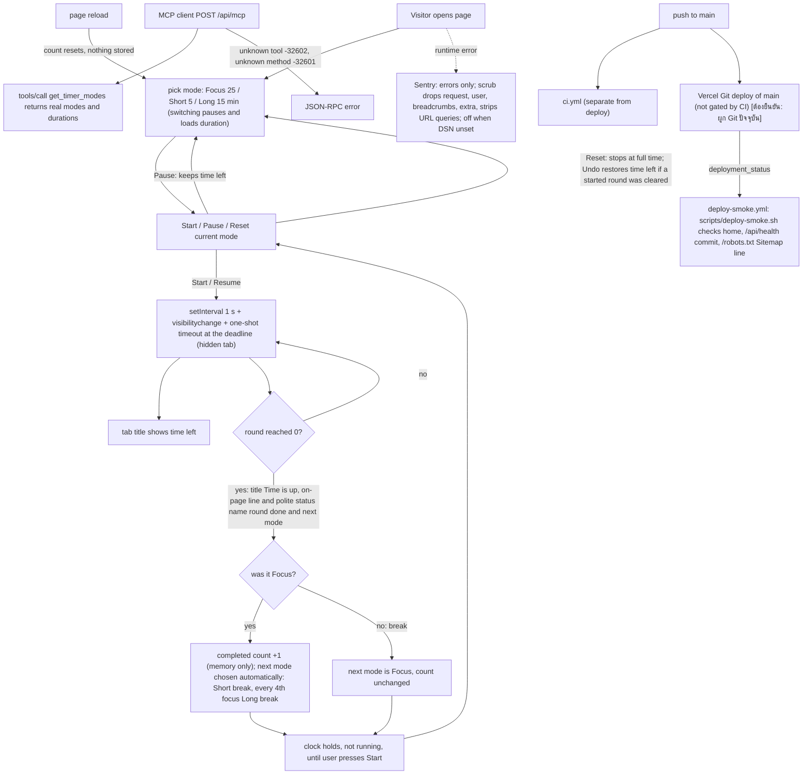

# 01 — Business process (As-Is / To-Be)

Pomodoro Timer คือนาฬิกาโฟกัสในเบราว์เซอร์ (Next.js) มีโหมด Focus 25 นาที, Short break 5 นาที และ Long break 15 นาที พร้อมนับรอบ Focus ที่เสร็จในหน่วยความจำ ไม่มีบัญชีหรือการเก็บข้อมูล (ข้อมูลไม่ถูกส่งออก ยกเว้นรายงานข้อผิดพลาดไป Sentry เมื่อมี DSN) มี `/api/mcp` ที่คืนโหมดและระยะเวลา และ `/api/health` สำหรับ smoke test หลัง deploy

Last reviewed: 2026-11-28 · commit `b0f8fbf`

## As-Is (จากโค้ดวันนี้)

Sources: `app/page.tsx`, `lib/timer.ts`, `lib/mcp.ts`, `app/api/mcp/route.ts`, `app/api/health/route.ts`, `scripts/deploy-smoke.sh`, `.github/workflows/deploy-smoke.yml`, `lib/sentry.ts`, `README.md`, `PRODUCT.md`

ข้อเท็จจริงสำคัญจากโค้ด:

- ไม่มีเสียง การแจ้งเตือนของเบราว์เซอร์ หรือประวัติรอบ: สัญญาณเมื่อจบรอบคือชื่อแท็บ "Time is up", ข้อความบนหน้า และ polite live region สำหรับโปรแกรมอ่านหน้าจอ
- การเปลี่ยนนาฬิการะบบไปข้างหน้าจำนวนมากถูกนับเป็นเวลาที่ผ่านไป (`PRODUCT.md` §Known limits)
- `/api/health` คืน commit จาก `VERCEL_GIT_COMMIT_SHA` เพื่อให้ smoke test ตรวจว่า production รันคอมมิตที่ deploy

## To-Be (ไม่มีแหล่งที่เขียนไว้)

ไม่มี To-Be ที่เขียนไว้

## Gap

| ID | As-Is → To-Be | Status | Owner | Evidence |
|---|---|---|---|---|
| G1 | ไม่มี To-Be ของกระบวนการเขียนไว้ → owner กำหนดเป้าหมาย (ฟีเจอร์/ขอบเขตถัดไป) หรือยืนยันว่า As-Is คือเป้าหมายสุดท้าย | decide | owner | ไม่มีใน `PRODUCT.md` / `README.md` / `specs/` |
